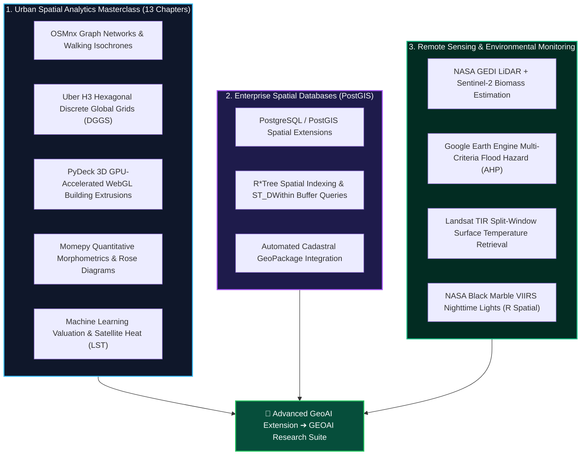

# 🗺️ GIS & Geospatial Data Science Portfolio
## Spatial Analytics, Urban Intelligence & Remote Sensing Masterclass

[](https://python.org)
[](https://postgis.net/)
[](https://earthengine.google.com/)
[](https://geopandas.org/)
[](https://h3geo.org/)
[](https://deckgl.readthedocs.io/)
[](https://orcid.org/0009-0008-8968-6999)
[](LICENSE)

> **Lead Researcher & Engineer:** **Emmanuel Yerbo**  
> *BSc Geography & Regional Planning (First Class Honours, GPA: 3.82/4.00, Three-Time Dean's Award Recipient) — University of Cape Coast, Ghana*  
> 🆔 [ORCID: 0009-0008-8968-6999](https://orcid.org/0009-0008-8968-6999) | 💼 [LinkedIn](https://www.linkedin.com/in/emmanuelyerbo) | 💻 [GitHub Profile](https://github.com/Emmanuel-Yerbo) | 🌐 [Interactive Portfolio](https://emmanuelyerbo.github.io/emmanuelyerbo)

---

## 📌 Executive Summary

This repository serves as a foundational and advanced engineering repository for **Geographic Information Systems (GIS)**, **Urban Spatial Data Science**, and **Satellite Remote Sensing**. It hosts the complete **13-Chapter Python for Urban Spatial Analytics Masterclass**, enterprise-grade **PostgreSQL/PostGIS** spatial database engines, and physical Earth Observation workflows applied to urban infrastructure, microclimates, and regional hydrology across Ghana.

> [!TIP]
> **Looking for Deep Learning & Vision Foundation Models?**  
> Cutting-edge deep learning architectures (Meta DINOv3-S Foundation Models, 3-Arm Ensemble ViTs, VideoMAEv2 Spatiotemporal Bushfire Transformers, and TorchGeo SegFormer pipelines) are hosted in our dedicated flagship research suite:  
> 🔗 [**GEOAI: Geospatial Artificial Intelligence & Deep Learning Research Suite (20 Projects)**](https://github.com/Emmanuel-Yerbo/GEOAI)

---

## 🏛️ Core Technical Pillars



---

## 🏙️ Python for Urban Spatial Analytics Masterclass (13 Chapters)

The complete end-to-end curriculum for modern computational urban planning and spatial intelligence:

| Chapter | Title & Focus | Primary Tools & Libraries | Key Analytical Outputs |
|:---:|---|---|---|
| **01** | **Setup & Geospatial Environment** | Conda, GeoPandas, Shapely, PyProj | Zero-conflict environment verification and CRS projection handling |
| **02** | **Urban Data Acquisition & Mining** | OSMnx, Overpass API, Requests | Automated vector extraction of administrative boundaries and POIs |
| **03** | **Building Footprint Analysis** | GeoPandas, Shapely, Matplotlib | Spatial geometry cleaning, area distribution, and compound density |
| **04** | **Road Network Topology** | OSMnx, NetworkX | Directional circuity factor, edge betweenness, and connectivity |
| **05** | **Urban Profiling & Typology** | Seaborn, Scipy, GeoPandas | Spatial distribution metrics across formal vs. informal settlements |
| **06** | **Urban Livability & Green Space** | Rasterio, NDVI, Buffer Spatial Joins | Per-capita open space access and park service catchment buffers |
| **07** | **Pedestrian Accessibility & Isochrones** | NetworkX (Dijkstra), Shapely | 5, 10, and 15-minute walking time catchments to healthcare clinics |
| **08** | **H3 Hexagonal Spatial Intelligence** | Uber H3, DGGS, GeoPandas | Aperture-7 spatial binning and invariant 6-neighbor contiguity |
| **09** | **3D Digital Twin & Extrusion** | PyDeck (deck.gl WebGL) | Real-time GPU rendering of volumetric building envelopes |
| **10** | **Spatial Clustering & Crisis Zones** | Scikit-Learn (DBSCAN, HDBSCAN) | Identification of infrastructure deficit and accident hotspot clusters |
| **11** | **Urban Morphometrics & Form** | Momepy, PySAL | Voronoi tessellation cells, circularity, and street polar roses |
| **12** | **Machine Learning Urban Valuation** | Scikit-Learn (Random Forest, XGBoost) | Spatial feature regression predicting infrastructure quality scores |
| **13** | **Satellite Urban Heat Island (UHI)** | Landsat TIR, Rasterio, GEE | 24-year microclimate thermal analysis and hotspot migration |

📁 *All scripts, interactive Jupyter Notebooks, and environment configurations are located in [`Python for Urban Analysis/`](./Python%20for%20Urban%20Analysis).*

---

## 🐘 Enterprise Spatial Database: PostGIS Masterclass

Located in [`Python for Urban Analysis/postgis_masterclass/`](./Python%20for%20Urban%20Analysis/postgis_masterclass):
- **Spatial Tables & Constraints**: Geometry (`ST_Point`, `ST_Polygon`, `ST_MultiLineString`) enforcement in EPSG:4326 and EPSG:32630 (UTM Zone 30N).
- **R\*Tree Spatial Indexing**: Acceleration of geometric intersection queries (`ST_Intersects`, `ST_Contains`) via `GIST` indices.
- **Topological Buffering & Routing**: Fast proximity indexing using `ST_DWithin` and shortest-path graph calculations with `pgRouting`.
- **Python Integration**: Seamless database read/write pipelines using `psycopg2`, `SQLAlchemy`, and `GeoPandas.read_postgis()`.

---

## 🌿 Remote Sensing & Earth Observation

- **Aboveground Biomass Estimation ([`REMOTE SENSING/Aboveground Biomass Estimation/`](./REMOTE%20SENSING/Aboveground%20Biomass%20Estimation))**: Spaceborne LiDAR biophysics (NASA GEDI L4A) combined with ESA Sentinel-2 MSI over the Kakum National Forest.
- **Cloud-Based Flood Hazard Zonation ([`REMOTE SENSING/Flood Susceptibility Mapping/`](./REMOTE%20SENSING/Flood%20Susceptibility%20Mapping))**: Google Earth Engine multi-criteria weighted overlay (AHP) fusing SRTM elevation, slope, and MERIT Hydro HAND.
- **Multispectral Indices ([`REMOTE SENSING/Indices/`](./REMOTE%20SENSING/Indices))**: Mathematical formulation and multi-temporal trajectories for NDVI, NDRE, EVI, and MNDWI.
- **Nighttime Lights Cartography ([`R SPATIAL ANALYSIS/CARTOGRAPHY/`](./R%20SPATIAL%20ANALYSIS/CARTOGRAPHY))**: NASA Black Marble VIIRS annual radiance calibration, logarithmic compression, and dark-sky cartography in R (`terra`, `sf`, `leaflet`).

---

## 🛠️ Geospatial Technology Stack

| Category | Tools & Libraries |
|---|---|
| **Spatial Core** | GeoPandas, Shapely, PyProj, Fiona, Rasterio, GDAL |
| **Urban Analytics** | OSMnx, NetworkX, Momepy, Uber H3 (DGGS), Libpysal |
| **3D & Interactive WebGL** | PyDeck (deck.gl), Leafmap, Folium, Mapbox |
| **Spatial Databases** | PostgreSQL 16, PostGIS 3.4, SQLite / OGC GeoPackage |
| **Cloud Remote Sensing** | Google Earth Engine (Python & JavaScript API), Geemap |
| **Cartography & Statistics** | Matplotlib, Seaborn, Contextily, R (`terra`, `sf`, `ggplot2`) |

---

## 📜 Citation & Academic Attribution

```bibtex
@misc{yerbo2025gisportfolio,
  author       = {Emmanuel Yerbo},
  title        = {GIS and Geospatial Data Science Portfolio: Spatial Analytics, Urban Intelligence, and Remote Sensing Masterclass},
  year         = {2025},
  publisher    = {GitHub},
  howpublished = {\url{https://github.com/Emmanuel-Yerbo/GIS}},
  note         = {ORCID: 0009-0008-8968-6999}
}
```
